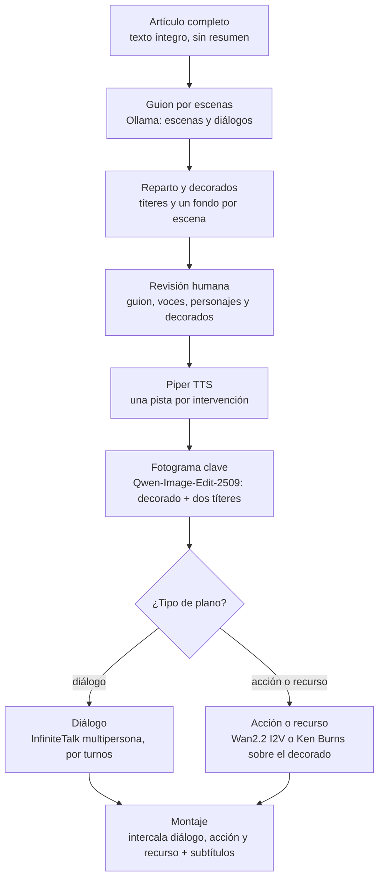

# video-studio — Propuesta de mejoras

18 de octubre de 2026 · Felipe

## Contexto

El código de `FelipePepe/video-studio` (v0.1.0, commit `bf51f3b`) está muy bien cuidado: tipado, cancelación con `AbortSignal` hasta la GPU y unos 350 tests. Las mejoras van por la calidad del vídeo final y el coste en GPU, no por la calidad del código.

Se revisó el pipeline completo: orquestador, runner de jobs, workflows de ComfyUI, helpers de ffmpeg, extracción del artículo y generación del borrador. Las secciones van ordenadas por impacto.

## 1. Calidad del vídeo

El mayor riesgo de calidad es que solo se usa uno de los dos expertos de Wan2.2. Esto encaja con lo que dice el README: el pipeline aún no está verificado de extremo a extremo contra ComfyUI real.

**Solo se usa uno de los dos modelos de Wan2.2.** En `comfy/workflows.ts`, T2V e I2V cargan únicamente `*_high_noise_14B` y hacen los 50 pasos con él. Wan2.2 A14B es un MoE: el experto de *high noise* hace los primeros pasos (composición) y el de *low noise* los últimos (detalle). Si todo lo hace el de high noise, el resultado sale borroso o con ruido. Solución: encadenar dos `WanVideoSampler` con `start_step`/`end_step`, cambiando de modelo hacia el 85–90 % de los pasos.

**Hay que ganar velocidad.** Son 50 pasos con un 14B por cada imagen fija y otros 50 por cada transición. Con LoRAs de destilado (tipo lightx2v/Lightning) se baja a 4–8 pasos con una pérdida pequeña. Para las imágenes fijas, usar T2V con `numFrames: 1` es caro; un workflow T2I dedicado sería más rápido y probablemente mejor.

**No hay coherencia visual entre escenas.** Cada `visualPrompt` es independiente, así que una escena puede no parecerse en nada a la anterior. Propuesta: un campo global `style` en la escaleta (y opcionalmente personajes), generado por Ollama, editable en la revisión y antepuesto a todos los prompts.

## 2. Bugs reales

Hay tres fallos que afectan directamente al vídeo que se entrega; los dos primeros se arreglan rápido.

| Bug | Dónde | Por qué pasa | Arreglo |
| --- | --- | --- | --- |
| El vídeo vertical corta los subtítulos | `verticalCropArgs` (`media/ffmpeg.ts`) | Recorta `final.mp4`, que ya lleva los subtítulos quemados a 1280 px de ancho; el recorte central deja 405 px | Recortar desde `muxed.mp4` (sin subtítulos) y quemarlos después con un estilo propio para 9:16 |
| El artículo se extrae mal | `htmlToText` (`pipeline/article.ts`) | Se queda con menús, pie, cookies y relacionados; solo decodifica 6 entidades, así que `&aacute;`, `&ntilde;` o `&#8217;` llegan sin convertir | `@mozilla/readability` + `linkedom` |
| La portada sale con subtítulos | `coverArgs` en el orquestador | Se extrae a mitad de `final.mp4`, con subtítulos quemados, y puede caer en una transición | Tomarla de una imagen fija (escena 1 o elegida por el usuario) |

## 3. Reintentos sin volver a renderizar todo

Una caché por contenido es lo que más horas de GPU ahorra. Hoy cada job trabaja en un `workDir/<jobId>` nuevo: si falla el montaje final, el reintento vuelve a generar todo el TTS, todas las imágenes y todas las transiciones.

Como las semillas ya son deterministas (`seedFor(draftId, i)`), se puede indexar cada resultado por hash: prompt + semilla + versión del workflow para las imágenes, texto + voz para el TTS. Así, si solo se edita la escena 4, se regeneran esa escena y sus dos transiciones.

- **Piper y ComfyUI en paralelo.** Piper no usa la GPU, así que el TTS puede ir a la vez que las imágenes.
- **Previsualizar las imágenes antes de las transiciones.** Otro punto de revisión barato antes de la parte más cara.

## 4. Ritmo del montaje

Con 12 escenas, el vídeo acumula unos 22 s sin voz solo por las transiciones.

- **Silencios durante las transiciones.** Cada una mete unos 2 s de silencio (33 frames a 16 fps). Se puede solapar la transición con el final de la narración o meter la música ahí.
- **Ken Burns siempre igual.** Siempre es un zoom al centro. Variar la dirección (zoom out, desplazamientos laterales) con la semilla de cada escena lo haría menos monótono.
- **Tirones en las transiciones.** Se generan a 16 fps y `normalizeClipArgs` las pasa a 24 duplicando frames. `minterpolate` (o RIFE en ComfyUI) lo suaviza.
- **Demasiadas recodificaciones.** Ken Burns, luego quemar subtítulos, luego el recorte vertical: tres codificaciones seguidas. Se puede juntar todo en un único `filter_complex` final.

## 5. Mantenimiento

Son cambios pequeños que evitan problemas de disco, de red y de PRs sin verificar.

- **No hay limpieza de `workDir`.** Cada job deja varios MP4 intermedios y el disco crece sin límite. Hace falta una política de retención.
- **El servidor escucha en todas las interfaces y sin autenticación** (`app.listen(port)`). Cualquiera en la red puede cambiar los hosts con `PATCH /api/config`, y `music` acepta cualquier ruta del servidor (ya anotado en la revisión de E1). Para una herramienta personal basta con escuchar en `127.0.0.1` o la IP de la LAN y añadir un token sencillo.
- **No hay CI.** Lefthook protege los commits locales, pero no los PRs. Un workflow de GitHub Actions con `pnpm -r test && pnpm -r typecheck` es poco trabajo.
- **Detalles desactualizados.** El `package.json` todavía dice "Kokoro TTS" y el README afirma en su línea 12 que el repo es privado, siendo ya **público** (confirmado con `gh api: "public"`). Corregir ambos.

## 6. Documental con títeres

> **Estado: decisión de producto separada, fuera del orden recomendado.** No es una mejora del vídeo actual, sino un nuevo caso de usar (de artículo narrado a ficción con lip-sync). Se documenta aquí para evaluar, pero no va en la cadena del punto «Orden recomendado».

Cada vídeo pasa a ser un documental con forma de película: títeres de fieltro originales que conversan e interactúan entre sí, dentro de decorados relacionados con lo que cuenta el texto, y que dicen el artículo completo con la boca sincronizada. Las piezas existen en ComfyUI: edición multi-imagen para meter a los personajes en el decorado y modelos de vídeo guiados por audio para el diálogo.

**Formato de película.** El documental se divide en escenas. Cada escena tiene un decorado propio sacado del fragmento del texto (un laboratorio, una calle de 1920, un mercado…) y en ella los personajes hablan entre sí, no a cámara. Tipos de plano dentro de cada escena:

- **Diálogo a dos:** los dos personajes en el decorado, dándose paso; es el plano principal.
- **Primer plano:** el personaje que habla, para frases largas o momentos importantes.
- **Acción sin diálogo:** los personajes se mueven por el decorado (señalan, caminan, reaccionan) mientras suena la voz.
- **Plano de recurso:** solo el decorado o un detalle, con voz en off, para dar respiro y abaratar.

**Guion por escenas (escaleta v2).** La escaleta deja de ser una lista de escenas con narración y pasa a tener:

- `cast`: personajes con `id`, nombre, descripción visual y voz de Piper. El campo `voice` por escena y el modo `mix` con dos voces ya apuntan en esta dirección.
- `scenes`: cada escena con `setting` (prompt del decorado, sacado del texto), `cast` presente (máximo dos personajes) y `lines`.
- `lines`: cada intervención con `speaker`, `text`, `shot` (`dialogue`, `closeup`, `action` o `broll`) y una `action` opcional ("señala el mapa", "se ríe").

La escaleta vive hoy como una columna JSON validada en `draft.ts`; cambiar su esquema hará que el validador rechace los **drafts ya guardados**. Antes de aceptar el formato nuevo hay que añadir un campo `version` y una migración/compatibilidad con la v1 (en `types.ts`, `draft.ts` y la UI de revisión).

**Texto completo, no resumen.** Ollama ya no resume: reparte el artículo entero en intervenciones y asigna quién dice cada una. Un validador comprueba que la suma de las intervenciones cubre el artículo. El tope de caracteres está en **dos** constantes idénticas de 12.000, ambas truncan en silencio: `MAX_TEXT_CHARS` (ruta por URL, `article.ts`) y `MAX_ARTICLE_CHARS` (texto pegado, `draft.ts`); además `MAX_NARRATION` (1.200) y `MAX_SCENES` (20) en `draft.ts`. Subir las cuatro.

**Reparto fijo.** Cada personaje se genera una vez como imagen de referencia, se aprueba en la revisión y se reutiliza en todos sus planos. Esto resuelve también el problema de coherencia visual del punto 1.

### Componer cada escena

Cada escena se arma en tres pasos, y el primero es el que garantiza que los personajes son los mismos en todo el documental.

1. **Fotograma clave.** Se genera el decorado a partir de `setting` y se meten los personajes con [Qwen-Image-Edit-2509](https://www.runcomfy.com/comfyui-workflows/qwen-image-edit-2509-in-comfyui-multi-image-merge-edit), que admite hasta tres imágenes: el decorado como lienzo y las referencias de los dos personajes. De ahí sale el límite de dos personajes por escena.
2. **Diálogo.** [InfiniteTalk multipersona](https://www.runcomfy.com/models/community/infinite-talk/fast/multi) anima el fotograma con una pista de audio por personaje. Su opción de orden (`left_right` o `right_left`) hace que hablen por turnos, que es justo una conversación.
3. **Acción.** Para los planos sin diálogo, Wan2.2 I2V (lo que ya usa el pipeline) anima el fotograma con la `action` como prompt.

Opcional: [Wan2.2 Animate](https://comfyui-wiki.com/en/tutorial/advanced/video/wan2.2/wan2-2-animate) copia el movimiento y la expresión de un vídeo de referencia a un personaje. Si una escena necesita un gesto concreto, puedes grabarte haciéndolo y que el títere lo repita.

### Pipeline nuevo

Reparto y decorados se aprueban junto al guion; cada escena arranca de un fotograma con los títeres ya en su decorado, y de ahí salen los planos de diálogo y de acción que el montaje intercala.

### Motores de lip-sync

InfiniteTalk es el mejor candidato como motor principal: no tiene límite de duración, admite varios personajes y tiene nodo nativo en ComfyUI. Wan2.2 S2V queda como alternativa si hace falta 720p.

| Motor | Base | Resolución | Duración | Varios personajes | ComfyUI | Encaje |
| --- | --- | --- | --- | --- | --- | --- |
| [InfiniteTalk](https://docs.comfy.org/tutorials/video/wan/wan-infinitetalk) | Wan2.1 I2V 14B | 480p | Sin máximo: se encadenan extensiones de unos 3,24 s (81 frames a 25 fps) | Sí: una pista de audio por personaje y turnos con left\_right o right\_left | Nodo nativo `WanInfiniteTalkToVideo`, con LoRA lightx2v | Motor principal |
| [Wan2.2 S2V](https://huggingface.co/wan-ai/wan2.2-s2v-14b) | Wan2.2 S2V 14B | 480p y 720p | Se ajusta a la duración del audio | No documentado | Integración marcada como completada | Alternativa para 720p; admite guía por pose |
| [MultiTalk](https://github.com/MeiGen-AI/MultiTalk) | Wan2.1 I2V 14B | 480p (720p solo multi-GPU) | Hasta 15 s | Sí: audio multipista | WanVideoWrapper (Kijai) | Planos cortos de conversación; los autores dicen que generaliza a dibujos animados |
| [HuMo](https://comfyui-wiki.com/en/models/humo/humo) | DiT propio, 1,7B y 17B | No documentada | No documentada | No documentado | Soporte oficial de Comfy | A probar: la versión de 1,7B es ligera |
| [Ovi](https://comfyui-wiki.com/en/models/ovi) | Wan2.2 A14B, audio y vídeo a la vez | No documentada | No documentada | No documentado | WanVideoWrapper (Kijai) | Descartado: genera su propio audio y se perdería el control del texto y de Piper |

Wan2.2 S2V, MultiTalk, HuMo y Ovi tienen licencia Apache-2.0; la de InfiniteTalk no está comprobada. Ninguna fuente confirma cómo funcionan con títeres, que tienen la boca articulada en lugar de labios.

### Riesgos y primer paso

Antes de tocar el pipeline hay que hacer una prueba corta en babybeast, porque dos de los riesgos solo se resuelven probando.

- **Coste de render.** El texto completo de un artículo de 12.000 caracteres son unos 12–13 minutos hablados (estimación aproximada a 150 palabras por minuto). Con InfiniteTalk eso son unas 230 extensiones de 3,24 s. Para contenerlo: parte del texto como voz en off sobre planos de recurso, la LoRA lightx2v, y render a 480p con reescalado al final.
- **Bocas de títere.** Estos modelos se entrenan con caras humanas y un títere abre y cierra una boca articulada. Ninguna fuente lo confirma; puede salir bien, salir con labios humanos o no moverse.
- **Personajes que cambian entre escenas.** Ninguna fuente garantiza que Qwen-Image-Edit-2509 conserve la identidad de un personaje al meterlo en decorados distintos. Si deriva, la alternativa es entrenar una LoRA por personaje.
- **Interacción limitada.** Dos personajes por plano, y la interacción física es la que Wan2.2 I2V consiga desde el prompt; los gestos precisos necesitarían Wan2.2 Animate con un vídeo de referencia.
- **Marca registrada.** "Muppets" y sus personajes son de Disney. Los personajes tienen que ser originales y los prompts no deben usar "Muppet" ni nombres de sus personajes; basta con describir el estilo: títere de fieltro, boca articulada, ojos grandes, decorado de plató.

**Plan por fases:**

- [ ] Spike: dos títeres en un decorado con Qwen-Image-Edit-2509, y 15 s de diálogo con InfiniteTalk multipersona en babybeast. Medir minutos de render por segundo de vídeo, calidad de la boca y si los personajes se reconocen. Decidir si se sigue.
- [ ] Escaleta v2 con `cast`, `scenes` y `lines`, y el validador de cobertura del texto completo.
- [ ] Etapa de reparto y decorados: referencias de cada personaje y fondo de cada escena, con aprobación en la revisión.
- [ ] Composición del fotograma clave de cada escena.
- [ ] Render de diálogo (InfiniteTalk) y de acción o recurso (Wan2.2 I2V o Ken Burns).
- [ ] Montaje: intercalar diálogo, acción y recurso, con subtítulos por intervención.

## 7. Más mejoras

Las más rentables son tres: normalizar el volumen y añadir créditos, que son cambios pequeños, y la animática, que es la que más horas de GPU ahorra en el modo película.

### Sonido

- **Normalizar el volumen.** No hay `loudnorm` en `media/ffmpeg.ts`, así que cada vídeo sale con un volumen distinto. Una pasada de normalización a −14 LUFS en el montaje final (lo habitual en YouTube) lo iguala.
- **Voces de títere.** Piper suena a locutor. Un cambio de tono por personaje en ffmpeg (`rubberband` o `asetrate`) da a cada títere una voz caricaturesca sin cambiar de motor de TTS. Más adelante, un campo `emotion` por intervención daría más expresividad.
- **Ambiente y efectos por decorado.** Una escena en un mercado debería sonar a mercado. Hay modelos de vídeo a audio en ComfyUI (MMAudio, por ejemplo) que generan el ambiente a partir del clip, y la música podría cambiar según el tono de cada escena en lugar de ser una sola pista.

### Guion

- **Esquema JSON real en Ollama.** `clients/ollama.ts` pide `format: 'json'`, que garantiza JSON válido pero no su forma. Ollama acepta un JSON Schema en ese mismo campo; con la escaleta v2 evitaría muchos rechazos del validador.
- **Guion en dos pasadas.** El modelo por defecto es `qwen3:8b`, y escribir de una vez una película con reparto y diálogos a partir de un artículo entero es mucho. Primero un esquema de escenas y luego el diálogo de cada escena da mejores guiones; encaja con el Qwen 27B de babybeast.
- **Créditos y fuente.** El `sourceRef` se guarda pero no aparece en el vídeo. Un rótulo final con artículo, autor y URL es lo mínimo. Publicar vídeos con el texto completo de artículos ajenos necesita permiso del autor; para uso personal no hay problema.

### Revisión antes de gastar GPU

- **Animática.** Antes del render caro, un montaje rápido con los fotogramas clave, el audio de Piper y Ken Burns. Se ven ritmo, guion y decorados en minutos, y solo después se lanzan lip-sync y Wan. En el modo película, con renders de horas, es lo que más trabajo tirado evita.
- **Duración y tiempo estimados.** Mostrar en la revisión cuánto durará el vídeo y cuánto tardará en renderizarse, calculado con los tiempos medidos en jobs anteriores.

### Robustez

- **Reanudar tras un reinicio.** `failInterruptedJobs` marca como fallido todo job en marcha al arrancar, así que reiniciar el backend tira un render de horas. Con la caché por contenido del punto 3, el job podría seguir donde se quedó.
- **Prueba nocturna de extremo a extremo en babybeast.** Una tarea programada que renderice un borrador corto de referencia contra ComfyUI real y avise si algo se rompe. Cubre el hueco que reconoce el README.

### Publicación

- **Capítulos y metadatos.** El montaje ya conoce la duración de cada escena, así que los capítulos con marcas de tiempo salen gratis. Se completan con título, descripción y etiquetas generados por Ollama, y una portada con el título rotulado.
- **Doblaje a otros idiomas.** InfiniteTalk es en el fondo un modelo de doblaje. Con fotogramas clave y decorados ya hechos, una versión en inglés solo necesita traducir, pasar por TTS y repetir el lip-sync, sin regenerar el resto.

## 8. Optimización del código

Lo que más se nota en el día a día es el WebSocket de ComfyUI (progreso real), las descargas en streaming y los presets rápidos en los intermedios. Aquí no se repite lo ya cubierto en el doc: caché por contenido, TTS en paralelo y un único `filter_complex`.

### Rendimiento

- **Imágenes fijas sin viaje extra.** Para cada escena, ComfyUI genera un MP4 de un frame, se descarga y ffmpeg saca el PNG (`extractFrameArgs`). Con un nodo `SaveImage`, ComfyUI devuelve el PNG directamente: un ffmpeg y una transferencia menos por escena.
- **Subir cada imagen una sola vez.** En el bucle de transiciones, la imagen `i+1` se sube como final de una transición y otra vez como inicio de la siguiente. Basta con reutilizar el nombre que devuelve ComfyUI.
- **Descargas en streaming.** `ComfyClient.download` hace `arrayBuffer()` y luego `writeFileSync`: todo el MP4 en RAM y una escritura síncrona que bloquea el event loop, y con él el SSE de progreso. Mejor volcar la respuesta a disco con `stream.pipeline` y `fs/promises`, igual que el resto de lecturas y escrituras síncronas del orquestador.
- **WebSocket de ComfyUI en vez de polling.** `waitForCompletion` consulta `/history` cada 2 s. El WebSocket emite progreso por paso: elimina el polling y la UI puede mostrar el avance dentro de cada render.
- **Presets rápidos en los intermedios.** `kenBurnsArgs` y `normalizeClipArgs` usan libx264 con el preset por defecto (`medium`) en clips que se vuelven a codificar. Con `-preset veryfast` (o sin pérdida) en los intermedios y calidad solo en la codificación final, se ahorra mucho tiempo de CPU.
- **Ken Burns en paralelo.** Cada escena es un ffmpeg independiente; se pueden lanzar varios a la vez con un límite de concurrencia mientras la GPU trabaja en otra cosa.

### Limpieza

- **Orquestador por etapas.** `createExecute` es una sola función de unas 220 líneas que hace TTS, imágenes, transiciones y montaje. Con una función por etapa y un contexto compartido se lee y se prueba mejor, y prepara la caché, la reanudación y el modo documental, que necesitan etapas reutilizables. Conviene hacerlo antes que ellos.
- **Final del montaje sin duplicar.** Las cuatro ramas de música × subtítulos (líneas 244–276 de `orchestrator.ts`) repiten `existsSync`, `musicMixArgs` y el mux. Se puede reescribir como una cadena de pasos opcionales (mezclar, quemar subtítulos, recortar a vertical), que además encaja con el arreglo del vertical que corta los subtítulos.
- **Sin aserción de tipo forzada.** `format as NonNullable<…>` desaparece comprobando `format` una sola vez al terminar el TTS.

## Orden recomendado

Primero la calidad base, porque si Wan2.2 no da buen resultado lo demás importa poco.

1. Los dos expertos de Wan2.2 y una prueba de extremo a extremo contra ComfyUI real.
2. El orquestador por etapas (sección 8), que despeja el camino a la caché y la reanudación; se hace **antes** que la caché.
3. La caché por contenido para los reintentos, apoyada en esas etapas.
4. El arreglo de subtítulos en vertical y la extracción con Readability, que son rápidos.

Cada cambio va en una rama `feature/*`, siguiendo el GitFlow del repo.

## Fuentes

- [Wan InfiniteTalk — documentación de ComfyUI](https://docs.comfy.org/tutorials/video/wan/wan-infinitetalk)
- [InfiniteTalk — artículo en arXiv](https://arxiv.org/abs/2508.14033v1)
- [InfiniteTalk multipersona — RunComfy](https://www.runcomfy.com/models/community/infinite-talk/fast/multi)
- [Wan2.2-S2V-14B — Hugging Face](https://huggingface.co/wan-ai/wan2.2-s2v-14b)
- [Wan2.2 S2V — workflow de RunComfy](https://www.runcomfy.com/comfyui-workflows/wan2-2-s2v-in-comfyui-workflow-audio-to-talking-video)
- [Wan2.2 Animate — ComfyUI Wiki](https://comfyui-wiki.com/en/tutorial/advanced/video/wan2.2/wan2-2-animate)
- [Qwen-Image-Edit-2509 multi-imagen — RunComfy](https://www.runcomfy.com/comfyui-workflows/qwen-image-edit-2509-in-comfyui-multi-image-merge-edit)
- [MultiTalk — GitHub de MeiGen-AI](https://github.com/MeiGen-AI/MultiTalk)
- [HuMo — ComfyUI Wiki](https://comfyui-wiki.com/en/models/humo/humo)
- [Ovi — ComfyUI Wiki](https://comfyui-wiki.com/en/models/ovi)
